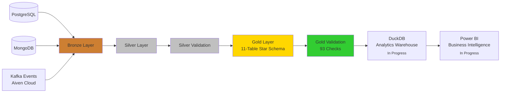
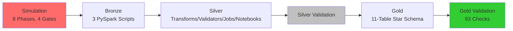

# End-to-End Streaming Data Platform

> A sports-streaming data platform with multi-source ingestion, event-driven processing, and Medallion Architecture — built with Docker, Kafka, Spark, and a 93-check validation suite.

[]()
[]()
[]()
[]()

## Overview

This project implements a football-video streaming data platform end-to-end: three source systems (PostgreSQL, MongoDB, Kafka), Medallion Architecture (Bronze → Silver → Gold), and a 93-check validation suite on the Gold layer.

The simulation engine generates deterministic, referentially-consistent test data across all sources using an 8-phase orchestration pipeline with 4 progressive quality gates. The Gold layer is an 11-table star schema (6 dimensions, 5 facts). Everything runs in Docker (Spark, PostgreSQL, MongoDB, MinIO) with Kafka on Aiven Cloud. The analytics layer (DuckDB + Power BI) is **in progress** — see Roadmap.



## Architecture Highlights

| Layer | Components | Status |
|-------|------------|--------|
| **Bronze** | 3 PySpark ingestion scripts (`postgres_to_bronze.py`, `mongo_to_bronze.py`, `kafka_to_bronze.py`) writing raw Parquet to MinIO | ✅ Complete |
| **Silver** | 3 transform modules + 3 validators + 3 job orchestrators + exploration notebooks per source (EDA/transform/validation combined) | ✅ Complete |
| **Gold** | **11-table Star Schema** (6 dimensions + 5 facts) written to MinIO/Parquet | ✅ Complete |
| **Validation** | **93 automated checks** across 3 suites: Schema/Counts (22), Keys/Integrity (25), Business Rules (46) | ✅ 93/93 passing |
| **Simulation** | 8-phase orchestration, 4 progressive quality gates, 3.5% anomaly target, deterministic replay (seed=42) | ✅ 30/30 tests passing |

## Tech Stack

| Tool | Role | Why |
|------|------|-----|
| PostgreSQL | Relational source system | Structured transactional data (users, subscriptions, payments) |
| MongoDB | NoSQL source system | Semi-structured document data (video metadata) |
| Kafka (Aiven Cloud) | Event streaming backbone | Decouples event production from consumption |
| Apache Spark | Distributed processing engine | Powers Bronze → Silver → Gold transformations |
| Docker | Local infrastructure orchestration | Runs full stack (Spark, PostgreSQL, MongoDB, MinIO) consistently |
| MinIO | Simulated cloud storage | S3-compatible local storage; native Spark S3A integration |
| DuckDB | Analytics warehouse | **In Progress** — exploratory notebook (`scripts/analytics_zone/dk.ipynb`); zero-copy query layer on Gold Parquet not yet built |
| Power BI | Business intelligence | **In Progress** — no deployed dashboards or semantic model yet |
| Pytest | Test framework | 30 deterministic simulator tests |
| Custom Assertion Framework | Validation engine | 93-check Gold validation suite (Great Expectations-style) |

## Gold Layer — Star Schema (11 Tables)

### Dimensions (6)
| Table | Grain | Surrogate Key | Purpose |
|-------|-------|---------------|---------|
| `dim_user` | One row per user | `user_sk` | Conformed user dimension with country, status, tenure |
| `dim_plan_pricing` | One row per plan/pricing combination | `plan_pricing_sk` | Centralized pricing reference (R15: single source of truth) |
| `dim_device` | One row per device type | `device_sk` | Device classification (mobile, tv, desktop, tablet) |
| `dim_date` | One row per day | `date_sk` | Calendar dimension covering simulation horizon (2025-01-01 to 2027-12-31) |
| `dim_match` | One row per match | `match_sk` | Football match metadata (competition, teams, kickoff) |
| `dim_video` | One row per video | `video_sk` | Video metadata linked to match (content_type, duration, status) |

### Facts (5)
| Table | Grain | Surrogate Key(s) | Purpose |
|-------|-------|------------------|---------|
| `fact_subscription` | One row per subscription | `subscription_sk` | Subscription lifecycle with MRR/ARR, plan pricing, truncation flags |
| `fact_payment` | One row per payment attempt | `payment_sk` | Payment transactions with amount validation, retry logic (R15: attempt_no, billing_reason) |
| `fact_event` | One row per interaction event | `event_sk` | Atomic Kafka events (play, pause, like, complete) with device, video, date FKs |
| `fact_video_engagement` | One row per video per day | `video_sk`, `date_sk` | Daily engagement aggregates (views, watch_time, likes, completion_rate) |
| `fact_user_daily` | One row per user per day | `user_sk`, `date_sk` | Daily user activity rollup (sessions, watch_time, events, active_flag) |

All tables exported via `scripts.storage.gold.__init__` with declared schema contracts (`*_SCHEMA` constants).
## Validation Suite — 93 Checks, 3 Suites

| Suite | Checks | Coverage | CLI Flag |
|-------|--------|----------|----------|
| **Schema & Row Counts** | **22** | 11 tables × (existence + row_count > 0 + schema conformance) | `--suite schema` |
| **PK Uniqueness & FK Integrity** | **25** | 11 Primary Keys + 14 Foreign Key relationships | `--suite keys` |
| **Business Rules** | **46** | Revenue consistency, payment validation, event quality, engagement reconciliation, user daily rollup, date partition alignment, device/video consistency | `--suite business` |
| **Total** | **93** | All Gold tables, all domains | `--suite all` |

**Runner** (executes inside Spark/Jupyter Docker container):
```bash
python3 -m scripts.storage.gold.validation.run_validation --suite all --verbose
python3 -m scripts.storage.gold.validation.run_validation --suite schema --fail-fast
python3 -m scripts.storage.gold.validation.run_validation --suite keys
python3 -m scripts.storage.gold.validation.run_validation --suite business
```

Each check returns a structured `ValidationResult` with `check_name`, `passed`, `message`, and optional `details`/`violation_count`. The master suite exits non-zero on any failure.

## Simulation Engine — 8 Phases, 4 Quality Gates

The simulation (`scripts/simulation/run_simulation.py`) generates all source data deterministically:

| Phase | Name | Quality Gate |
|-------|------|--------------|
| 1 | Initialize & Clock | `BusinessClock` (UTC, seed=42), `RandomProvider` (single instance), `MatchRegistry` |
| 2 | PostgreSQL Domain | **Gate I**: `assert_subscriptions_non_overlapping()` — strict sequential boundaries |
| 3 | MongoDB Domain | Match-Video consistency via `MatchRegistry` (R4/R5) |
| 4 | Temporal Isolation | **Gate II**: `assert_video_availability_windows_reachable()` — temporal anomalies caught pre-runtime |
| 5 | Session Engineering | Engagement-tiered sessions (HIGH/MEDIUM/LOW) via `SessionFactory` |
| 6 | Event Pipeline Flattening | **Gate III**: Pristine master check — multi-entity structural verification |
| 7 | Dirty Data Injection | **Gate IV**: Post-dirty integrity — anomalies within configured analytical limits (3.5% flat per-stream target) |
| 8 | Load & Produce | Parallel bulk load: PostgreSQL, MongoDB, Kafka producer |

**Anomaly Model**: Each stream (PostgreSQL users/subscriptions/payments, MongoDB videos, Kafka events) independently assigned 3.5% flat target rate. Volume-weighted blending emerges via Law of Large Numbers — high-volume streams stabilize near 3.5%, low-volume streams exhibit Poisson variance.

**Determinism (R19)**: Single `RandomProvider(seed=42)` shared across all modules → bit-for-bit replay. Verified by `tests/simulator/test_deterministic.py`.

**CLI** (runs on **Host/Windows**):
```bash
# Laptop-friendly default (1k users, 500 videos, 50k event ceiling)
py -m scripts.simulation.run_simulation --dry-run

# Full scale
py -m scripts.simulation.run_simulation --users 10000 --videos 10000 --events 100000

# Smoke test
py -m scripts.simulation.run_simulation --dry-run --users 50 --videos 50 --events 2400
```

## Test Suite — 30 Tests, 8 Files, 30/30 Passing

Located in `tests/simulator/`:

| File | Tests | Focus |
|------|-------|-------|
| `test_anomaly_rates.py` | 10 | Coordinator blended rate (3.5%), per-stream bounds [1%,5%], determinism, small-volume edge cases |
| `test_kafka_anomaly_rates.py` | 1 | Kafka event injection rate within bounds |
| `test_mongo_anomaly_rates.py` | 1 | MongoDB video injection rate within bounds |
| `test_schema_hardening.py` | 6 | R15: PaymentEntity `attempt_no` (1-3), `billing_reason` enum, `user_id` FK, `to_dict()` inclusion, factory validation |
| `test_streaming.py` | 2 | Deepcopy micro-mutation pattern: generator yield, independent copies |
| `test_deterministic.py` | 5 | R19: RandomProvider, Faker, IDGenerator, PostgresSimulation, VideoSimulation deterministic replay |
| `test_invariants.py` | 2 | Gate I (subscriptions non-overlapping), Gate II (video windows reachable, match artifacts unified) |
| `test_pristine_objects.py` | 3 | Pristine User/Subscription/Payment objects unchanged after dirty injection |

**Run all (Host/Windows):**
```bash
py -m pytest tests/simulator/ -v
```
## Quick Start

### Prerequisites
- Docker Desktop
- Aiven Kafka credentials (`.env` with `KAFKA_BOOTSTRAP_SERVERS`, `KAFKA_SASL_USERNAME`, `KAFKA_SASL_PASSWORD`, `KAFKA_TOPIC`)
- Python 3.10+ on host (for simulation orchestrator and pytest)
- SSL certificate (`ca.pem`, `service.cert`, `service.key`) for Kafka

### Two Execution Environments

| Environment | What Runs Here | Commands |
|-------------|----------------|----------|
| **Host Machine (Windows)** | Simulation orchestrator, pytest suite | `py -m scripts.simulation.run_simulation`<br>`py -m pytest tests/simulator/ -v` |
| **Spark / Jupyter Docker Container** | Bronze/Silver/Gold PySpark jobs, Gold validation | `python3 -m scripts.storage.bronze.postgres_to_bronze`<br>`python3 -m scripts.storage.gold.validation.run_validation --suite all --verbose` |

### Full Pipeline

```bash
# 1. Host: Start infrastructure (PostgreSQL, MongoDB, MinIO, Spark, Jupyter)
docker-compose up -d postgres mongo minio spark-master spark-worker jupyter

# 2. Host: Run simulation — generates all 3 sources and writes to Bronze (MinIO)
py -m scripts.simulation.run_simulation --dry-run   # validate first
py -m scripts.simulation.run_simulation             # full run (defaults: 1k users, 500 videos, 50k ceiling)

# 3. Container (Jupyter/Spark): Silver layer processing
#    Option A: Notebooks (interactive, per source)
#      Open Jupyter at http://localhost:8888
#      Navigate to scripts/storage/silver/notebooks/
#      Run postgres_exploration.ipynb, mongo_exploration.ipynb, kafka_exploration.ipynb
#
#    Option B: PySpark job modules (scripted)
python3 -m scripts.storage.silver.jobs.postgres_silver
python3 -m scripts.storage.silver.jobs.mongo_silver
python3 -m scripts.storage.silver.jobs.kafka_silver

# 4. Container: Gold layer build (PySpark modules in scripts/storage/gold/)
#    Then run validation suite:
python3 -m scripts.storage.gold.validation.run_validation --suite all --verbose
```

At completion: Gold tables exist as Parquet in MinIO (`s3a://gold/`), validated with 93/93 checks passing.

## Project Structure

```
.
├── config.py                           # Central configuration (volumetric params, paths)
├── docker-compose.yml                  # 6 services: postgres, mongo, minio, spark-master, spark-worker, jupyter
├── Dockerfile                          # Multi-stage: spark-base → jupyter
├── pytest.ini                          # Test configuration
├── scripts/
│   ├── simulation/                     # 8-phase simulation orchestrator + domains
│   │   ├── run_simulation.py           # CLI entrypoint (Host)
│   │   ├── postgres/                   # User, Subscription, Payment entities + factory
│   │   ├── mongo/                      # VideoSimulation, match-aware content generation
│   │   ├── kafka/                      # InteractionEntity, video_events_producer
│   │   ├── dirty_data/                 # Micro-mutation injectors (Postgres, Mongo, Kafka)
│   │   ├── registry/                   # SessionFactory, billing_eligibility, match_registry
│   │   ├── anomalies/                  # AnomalyCoordinator (3.5% flat target, volume-weighted blend)
│   │   ├── clock.py                    # BusinessClock (single master cursor + forks)
│   │   ├── random_provider.py          # RandomProvider (single RNG, seed=42, R19)
│   │   ├── id_generator.py             # UUID7-based unique IDs
│   │   ├── invariants.py               # 4 Progressive Quality Gates (I–IV)
│   │   ├── temporal_registry.py        # Global availability map (R7)
│   │   └── loading/                    # Bulk loaders for PostgreSQL, MongoDB
│   ├── storage/
│   │   ├── bronze/                     # 3 PySpark ingestion scripts
│   │   │   ├── postgres_to_bronze.py
│   │   │   ├── mongo_to_bronze.py
│   │   │   ├── kafka_to_bronze.py
│   │   │   └── __init__.py
│   │   ├── silver/                     # Transforms, validators, jobs, notebooks
│   │   │   ├── transforms/             # postgres.py, mongo.py, kafka.py
│   │   │   ├── validation/             # postgres_validator.py, mongo_validator.py, kafka_validator.py, assertions.py
│   │   │   ├── jobs/                   # postgres_silver.py, mongo_silver.py, kafka_silver.py
│   │   │   ├── notebooks/              # postgres_exploration.ipynb, mongo_exploration.ipynb, kafka_exploration.ipynb
│   │   │   └── __init__.py
│   │   ├── gold/                       # 11-table Star Schema + 93-check Validation
│   │   │   ├── dim_user.py, dim_plan_pricing.py, dim_device.py
│   │   │   ├── dim_date.py, dim_match.py, dim_video.py
│   │   │   ├── fact_subscription.py, fact_payment.py, fact_event.py
│   │   │   ├── fact_video_engagement.py, fact_user_daily.py
│   │   │   ├── validation/
│   │   │   │   ├── schema_and_counts.py        # 22 checks
│   │   │   │   ├── keys_and_integrity.py       # 25 checks
│   │   │   │   ├── business_rules.py           # 46 checks
│   │   │   │   ├── run_validation.py           # Master runner (CLI)
│   │   │   │   └── assertions.py               # ValidationResult, ValidationSuite, assert_* helpers
│   │   │   └── __init__.py
│   │   └── config/                     # SparkSessionManager, IO utils (read_gold_dimension/fact)
│   ├── load_postgres.py                # Legacy loader (reference)
│   └── load_mongo.py                   # Legacy loader (reference)
├── tests/
│   └── simulator/                      # 30 tests / 8 files / 30 passing
│       ├── test_anomaly_rates.py
│       ├── test_kafka_anomaly_rates.py
│       ├── test_mongo_anomaly_rates.py
│       ├── test_schema_hardening.py
│       ├── test_streaming.py
│       ├── test_deterministic.py
│       ├── test_invariants.py
│       ├── test_pristine_objects.py
│       ├── conftest.py
│       └── __init__.py
└── docs/                               # Development notes and technical logs
```
## Development Workflow



- **Fail-fast gates**: Simulation (4 gates) → Validation (`--fail-fast`)
- **CI Commands**:
  ```bash
  # Host
  py -m pytest tests/simulator/ -v
  
  # Container (after Gold built)
  python3 -m scripts.storage.gold.validation.run_validation --fail-fast
  ```

## Roadmap

- [ ] DuckDB direct query layer on Gold Parquet (zero-copy) — **in progress**
- [ ] Power BI semantic model with pre-built measures — **in progress**
- [ ] Structured Streaming migration for Silver (batch → continuous)
- [ ] Airflow/Dagster orchestration for end-to-end pipeline scheduling
- [ ] Great Expectations integration for Silver/Gold contract testing
- [ ] Performance benchmarks: Spark tuning, partition strategies, MinIO throughput

## License

MIT — see `LICENSE` for details.